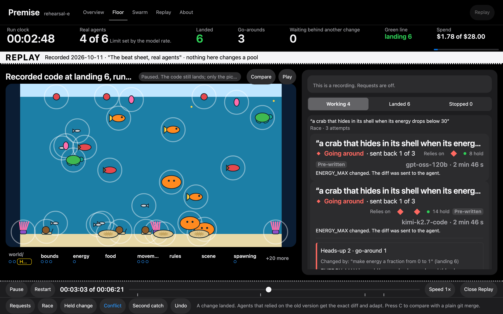
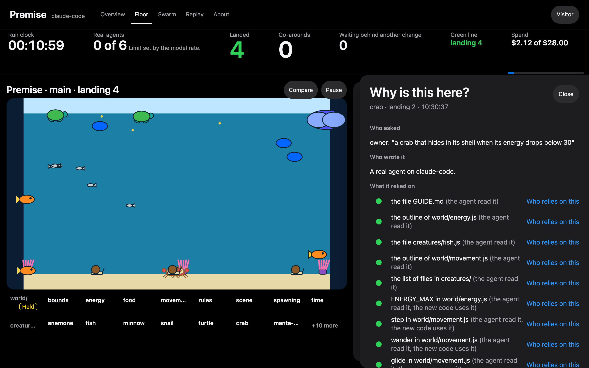
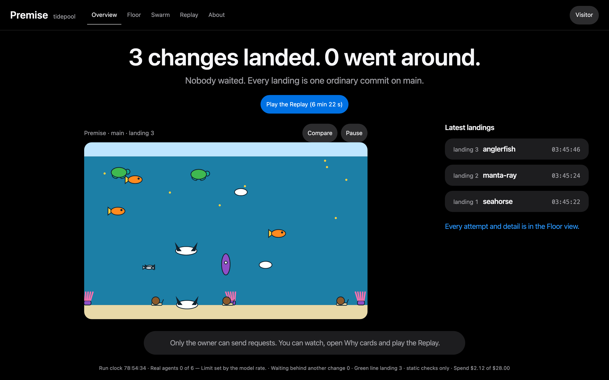

# Premise

Git records only what an agent wrote. Premise also records what it read.

A change lands while everything it relied on is still true, and goes back to its still-running agent with the exact diff when something it relied on changes.

Watch the demo video: **https://github.com/zaeem-rafiq/premise/releases/tag/demo-video**

Watch a recorded run in the browser, with no account and no key: **https://premise.rk3469.workers.dev/replay/hero**

Or see it happen live: open **https://premise.rk3469.workers.dev** and press **Try it**. You get your own copy of the tide pool, where scripted agents (no model calls) play the conflict in about a minute: a creature lands, a shared rule changes, and the agents that relied on it get the exact diff and adapt.

_The Floor during the recorded run. A shared rule ("make energy a fraction from 0 to 1") has just landed. The three crab attempts, each on a different model, relied on it, so each is going around with the exact diff while its agent keeps running._

_A crab written by a real Claude Code session that joined a production pool over MCP. Its Why card lists every read it relied on, each one a premise. The pool is live at https://premise.rk3469.workers.dev/p/claude-code._

## The idea

Many AI agents now change one codebase at the same time. The usual tools were made for one person per change: a branch keeps the change apart, a pull request asks for review, and a merge queue tests it against the others. All three check the text that was written. None of them knows what the writer relied on, so a change can merge without a conflict, pass the tests and still be wrong, because a value it used changed while it was being written.

Premise replaces that with one rule. Agents see code only through Premise's tools, and every read becomes a **premise**: the exact version of a function, a constant, a folder listing or a search result that the agent saw. Trunk, one object per codebase, lands a change while all of its premises still hold. When a landing changes something an attempt in flight relied on, that attempt gets a **heads-up** with the diff and the lines of its own work that use what changed, and its agent **goes around**: it adapts while it is still running. No agent declares what it depends on, and nothing is rebased.

The record of each landing is a git note on an ordinary commit in Cloudflare Artifacts: who asked and in which words, which model wrote it, what it relied on, what changed under it and what it did about that. The same record decides the landing, fills the owner's review card, answers "who relies on this", drives a causal undo, and plays back as a Replay.

## What you see

The page is called the Floor. It shows one codebase, a small simulated rock pool whose creatures follow shared rules, running live in the page.

- **Requests and attempts.** The owner types what they want. Each request becomes an attempt with a real agent on Workers AI; a request can race three models, and the owner picks one result.
- **Lights.** Every read is a light on the attempt's card. A light that turns red is a premise that stopped holding.
- **Heads-ups and go-arounds.** When a landing breaks a premise, the attempt moves to the top with the diff, goes around and lands again.
- **Shared rules wait for the owner.** A change to a file the pool's policy marks as shared waits on a card that shows the pool before and after, and how many attempts in flight it would send back.
- **Who relies on this.** Any file or entity lists the landed code and the attempts in flight that depend on it.
- **Why is this here.** Tap a creature: the card shows the record of the landing that made it, and "Show the git" gives the commit, its trailers, the note and the git commands that read them.
- **Compare.** The same changes merged by plain git, in a second repository built for the comparison, side by side with Premise's pool.
- **Undo.** Taking a landing back also sends back the landings that relied on it.
- **Swarm.** Scripted agents, always labelled SYNTHETIC, that use the same tools, premises and landing path, for load.
- **Replay.** Any recorded run plays through the same page with no credentials.

## How it is built

One Worker serves the page, the API and each pool's code at any commit. Four Durable Objects, each with SQLite storage, do the work: **Trunk** (one per pool) serves every read, pins premises, checks them in each landing batch in one transaction and is the only writer of `main`; **Agent** (one per attempt) runs the model's tool loop and survives restarts; **Floor** (one per pool) streams events to every open page; **ModelGate** (one per deployment) holds the rate limits, the spend cap and the kill switch. Artifacts holds each pool as a git repository, with `green` marking the newest landing whose code passed the pool's self-test in a Worker Loader isolate (the same self-test also runs before a change lands) and a second repository for the plain-merge comparison; each attempt gets its own repository with its transcript, operations and premises; every write is a push that names the old and the new value of each ref. Outside agents can join a pool over MCP. Workflows launch the Swarm. Workers AI runs the models.

The specification is in [`docs/spec/`](docs/spec/): [`01-core.md`](docs/spec/01-core.md) holds the rules and the protocol, and [`premise-cases.json`](docs/spec/premise-cases.json) holds 58 cases that the engine must pass.

## Run it

Watch a recorded run with no account and no key: open https://premise.rk3469.workers.dev/replay/hero

To run your own copy you need Node.js 22 (22.18 or later) with npm 10, git, and a Cloudflare account on the Workers Paid plan with Artifacts.

1. Install, from a clone of this repository:
   npm ci

2. Play a recording offline, with no Cloudflare account:
   npm run dev:floor
   Then open http://localhost:5173/replay/hero. The attempt cards, the lights and the numbers play. The pool picture needs a deployment.

3. Sign in to Cloudflare:
   npx wrangler login

4. Deploy. This runs every offline check, then deploys the Worker "premise" and prints its address:
   npm run deploy

5. Set the owner key, a long random secret that you keep. Without it every request that changes something answers 503:
   npx wrangler secret put OWNER_KEY

6. Create the default pool from the seed. Use the address that step 4 printed and the key of step 5:
   PREMISE_URL=https://premise.YOUR-SUBDOMAIN.workers.dev PREMISE_OWNER_KEY=YOUR-KEY npm run pool:create -- tidepool tidepool

7. Unlock the Floor: open the address, press "Visitor" in the header, paste the owner key into "Owner key" and press "Unlock". The header now reads "Owner", and you can type a request.

8. Run the checks at any time. They deploy nothing:
   npm run check

9. Connect an outside agent (optional). Mint a token for a pool, then add the pool to an MCP client:
   curl -X POST https://YOUR-ADDRESS/api/pools/tidepool/mcp-tokens -H "Authorization: Bearer <owner key>" -H "content-type: application/json" -d '{}'
   claude mcp add --transport http premise https://YOUR-ADDRESS/mcp/tidepool --header "Authorization: Bearer <token>"

## Measured

Every number comes from a file under [`docs/measurements/`](docs/measurements/).

- 58 of 58 case vectors pass through the engine: [`docs/measurements/cases.md`](docs/measurements/cases.md).
- The hero conflict with the scripted cast, run 20 times on a deployment, 10 in each landing order: in 20 of 20 runs the heads-up reached the dependent attempt before the landing it depended on, and both the Premise pool and the plain-merge pool ended with the expected code: [`docs/measurements/rehearsal/hero-20.json`](docs/measurements/rehearsal/hero-20.json).
- The workhorse model, `gpt-oss-120b`, landed 12 of 12 additive requests and 12 of 12 shared-rule requests in one pass, with a median of 94 s from request to landing: [`docs/measurements/models/2026-10-06-engine.md`](docs/measurements/models/2026-10-06-engine.md).
- Three models each landed at least 11 of 12 additive requests (the race uses all three): [`docs/measurements/models/2026-10-06-engine.md`](docs/measurements/models/2026-10-06-engine.md).
- A mark that was missed: after the shared energy rule changed, the shrimp's agent repaired its absolute number in 2 of 5 runs (the plan asked for 4 of 5): [`docs/measurements/models/2026-10-06-engine.md`](docs/measurements/models/2026-10-06-engine.md).
- 256 scripted agents on one Trunk, at five collision settings: 1.40 to 1.67 landings per second, a median time to land of 1.5 to 5.7 seconds, every attempt ended, one commit and one note per landing, and no pause longer than 2.7 seconds: [`docs/measurements/soak/README.md`](docs/measurements/soak/README.md).
- One Trunk did not carry 1,024 or 512 scripted agents, so the Swarm runs 256: [`docs/measurements/soak/README.md`](docs/measurements/soak/README.md).
- A real Claude Code session joined a production pool over MCP while a Workers AI agent changed the shared energy rule. It got the heads-up 3 s after the rule landed, wrote its crab against the shared value instead of the number 30, and landed. The pool is live at https://premise.rk3469.workers.dev/p/claude-code: [`docs/measurements/integration/2026-10-14-claude-code-mcp.md`](docs/measurements/integration/2026-10-14-claude-code-mcp.md).
- Clef, the triage judge, was calibrated on 54 labelled cases before it was switched on: no truly dependent case judged unaffected, p95 latency 741 ms: [`docs/measurements/calibration/2026-10-14-clef.md`](docs/measurements/calibration/2026-10-14-clef.md).
- The longest Trunk engine call in a local 256-agent run with 264 attempts in flight: 802 ms: [`docs/measurements/integration/2026-10-07-trunk-load.md`](docs/measurements/integration/2026-10-07-trunk-load.md).

## Limits

- Premise understands JavaScript, TypeScript, Python and Go modules: .js and .mjs in the tide pool, and .js, .mjs, .cjs, .jsx, .ts, .mts, .cts, .tsx, .py and .go in a pool imported from a repository. Other files are tracked as whole files.
- One Trunk serves one pool. Agents read and write files of at most 32,768 bytes. A repository with more than 5,000 entries or 24,000,000 bytes of text is not imported, and a larger file in an imported repository is kept but cannot be read.
- Real agents are limited by the Workers AI rate limits. This build runs at most 6 at once.
- Numbers in the Swarm view come from scripted agents. They make no model calls.
- The plain-merge pool is constructed by Trunk from the same changes. It is a comparison, not a second product. Each change is merged as git merges a file from three versions, and the version its agent started from is taken from the pool's history.
- A premise across two pools is not built.
- The green line checks every landing by running the pool's self-test in a sandboxed isolate.
- Clef judgments are on in this build.
- Not built: audience input.
- References are direct. Code that depends on a shared value only through another function it calls holds no premise on that value. A package import or a tsconfig path alias is external and gives no premise.
- In Python and Go, references are found by name and can be wrong both ways. Every Python or Go file an agent reads from is also watched as a whole, so any change to it asks the agent to confirm.
- A number written with no reference to the shared quantity is not caught by rule. If its agent read the quantity, Clef judges it, or the agent takes one confirm turn. If it did not, only the self-test could notice, and that test checks the pool's health, not what a creature was asked to do.
- Premise shows an agent every piece of code that uses what it changes. It does not prove that the agent adapted all of it.
- A sweep is recognised from the edits an agent makes, not from the words of the request.
- After a rebuild from Artifacts, open cards close and agents in flight register again. Landed history is rebuilt in full.
- An outside agent over MCP counts as a real agent. Premise sees only its calls of the seven tools: not what it read elsewhere, and not what its own model cost.

## This deployment

This deployment does not use a separate app host: the page, the API and the pools' code are served from one host, and the sandbox headers of rule SE13 are the boundary. The demo repository for imported pools is [`ai/nanoid`](https://github.com/ai/nanoid).

## Related work

Other work also checks what agents relied on: STORM (arXiv 2605.20563), CoAgent (arXiv 2606.15376), and the competition entry "dibs". Premise differs in these ways: reads are observed by the platform at the level of entities, listings and searches, and are never declared by the agent; premises are checked live while the agent works, not only when it submits; the record is stored as git notes in Artifacts, readable with plain git; and one record serves landing, review, why, who-relies and undo.

## License

[MIT](LICENSE)
